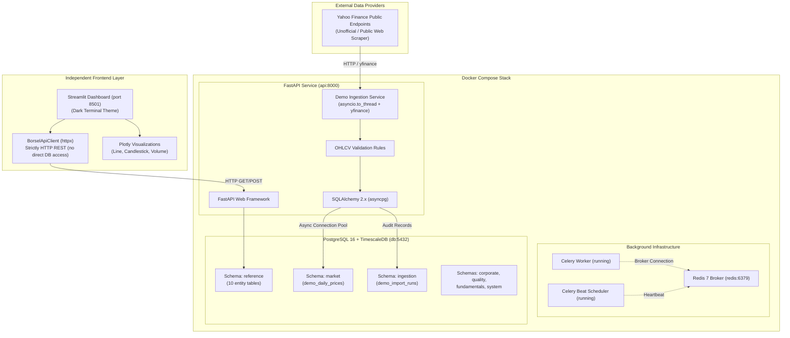

# Borsel Handler

> **Indian Stock Market Data Collection, Management, and Financial Analytics Platform (MVP)**

Borsel Handler is an extensible financial data management platform engineered to ingest, normalize, store, and visualize historical market data from the National Stock Exchange of India (NSE). 

The platform implements a modular database architecture backed by **PostgreSQL 16 with TimescaleDB**, an asynchronous **FastAPI** backend with **SQLAlchemy 2.x**, and a dark-themed financial terminal dashboard powered by **Streamlit** and **Plotly**.

---

## Table of Contents

- [1. Current Implementation Status](#1-current-implementation-status)
- [2. System Architecture](#2-system-architecture)
  - [End-to-End Data Flow](#end-to-end-data-flow)
  - [Architecture Diagram](#architecture-diagram)
  - [Component Responsibilities](#component-responsibilities)
  - [Celery & Background Infrastructure Clarification](#celery--background-infrastructure-clarification)
- [3. Database Architecture](#3-database-architecture)
  - [The Seven Logical Schemas](#the-seven-logical-schemas)
  - [Implemented Database Models](#implemented-database-models)
  - [Alembic Migration Pipeline](#alembic-migration-pipeline)
- [4. Environment Setup Guide](#4-environment-setup-guide)
  - [Prerequisites](#prerequisites)
  - [Step 1: Clone Repository](#step-1-clone-repository)
  - [Step 2: Configure Environment Variables & Security](#step-2-configure-environment-variables--security)
  - [Step 3: Build and Start Docker Services](#step-3-build-and-start-docker-services)
  - [Step 4: Database Readiness Check](#step-4-database-readiness-check)
  - [Step 5: Apply Database Migrations](#step-5-apply-database-migrations)
  - [Step 6: Trigger Initial Historical Data Ingestion](#step-6-trigger-initial-historical-data-ingestion)
  - [Step 7: Verify Stored Data](#step-7-verify-stored-data)
  - [Step 8: Setup & Launch Streamlit Dashboard](#step-8-setup--launch-streamlit-dashboard)
- [5. Market Data Ingestion Pipeline](#5-market-data-ingestion-pipeline)
  - [Tracked Securities](#tracked-securities)
  - [Ingestion Mechanism & Thread Offloading](#ingestion-mechanism--thread-offloading)
  - [Data Validation & Sanitization](#data-validation--sanitization)
  - [Idempotent Upsert Strategy](#idempotent-upsert-strategy)
  - [Audit Run Logging](#audit-run-logging)
  - [Data Provider Status Notice](#data-provider-status-notice)
- [6. REST API Documentation](#6-rest-api-documentation)
  - [Interactive Swagger & OpenAPI](#interactive-swagger--openapi)
  - [Health Check](#health-check)
  - [Stock Watchlist Summary](#stock-watchlist-summary)
  - [Stock Historical OHLCV Observations](#stock-historical-ohlcv-observations)
  - [Pipeline Overview & Metrics](#pipeline-overview--metrics)
  - [Trigger On-Demand Ingestion](#trigger-on-demand-ingestion)
  - [Ingestion Execution Run History](#ingestion-execution-run-history)
- [7. Test Suite & Verification](#7-test-suite--verification)
  - [Backend Test Suite (15 Tests)](#backend-test-suite-15-tests)
  - [Dashboard Test Suite (4 Tests)](#dashboard-test-suite-4-tests)
- [8. Repository Structure](#8-repository-structure)
- [9. Troubleshooting & FAQ](#9-troubleshooting--faq)

---

## 1. Current Implementation Status

| Feature / Subsystem | Status | Details |
| :--- | :--- | :--- |
| **Containerized Stack** | **Implemented** | 5 Docker services running: `api`, `worker`, `beat`, `db` (TimescaleDB), `redis`. |
| **Reference Database Schema** | **Implemented** | 10 core entity tables in `reference` schema with UUID PKs and temporal constraints. |
| **Market Data Pipeline** | **Implemented** | Thread-offloaded Yahoo Finance ingestion for 5 major NSE stocks (~1 year daily OHLCV). |
| **Database Migrations** | **Implemented** | Sequential Alembic migrations (`0001` -> `0002` -> `0003_create_demo_tables`). |
| **REST API Layer** | **Implemented** | Asynchronous FastAPI endpoints under `/api/demo` with Pydantic validation. |
| **Frontend Dashboard** | **Implemented** | Dark financial terminal dashboard using Streamlit, Plotly charts, and pure HTTP client. |
| **Automated Tests** | **Implemented** | 19 passing tests (15 backend async integration tests + 4 frontend client tests). |
| **Celery Scheduled Tasks** | *Planned* | Celery Worker, Beat, and Redis are running; scheduled periodic ingestion will be added in Phase 3. |
| **Corporate / Fundamentals Schemas** | *Planned* | Schemas created; production models to be implemented in subsequent phases. |
| **Direct NSE Bhavcopy Scraping** | *Planned* | Official exchange report parsing and raw archive storage planned for Phase 3. |

---

## 2. System Architecture

### End-to-End Data Flow

```text
[ Yahoo Finance Public Endpoints ]
         │  (yfinance / pandas)
         ▼
[ FastAPI Ingestion Service ]  ◄── Non-blocking thread offload (asyncio.to_thread)
         │  Validation: open, high, low, close > 0, high >= low, volume >= 0
         ▼
[ PostgreSQL 16 + TimescaleDB ]
   ├── market.demo_daily_prices    (Idempotent upsert on [symbol, date, data_source])
   └── ingestion.demo_import_runs  (Audit tracking: status, processed, failed, errors)
         │
         ▼
[ FastAPI REST Endpoints ]     ◄── Asynchronous SQLAlchemy AsyncSession (asyncpg)
         │  (/api/demo/stocks, /api/demo/summary, /api/demo/refresh, etc.)
         ▼
[ Streamlit Dashboard ]        ◄── Pure HTTP communication via BorselApiClient
   ├── Market Overview & Watchlist
   ├── Interactive Plotly Price & Volume Charts
   ├── Historical Data Table & CSV Export
   └── On-Demand Pipeline Trigger
```

### Architecture Diagram



### Component Responsibilities

1. **FastAPI Backend (`src/borsel/`)**:
   - Manages asynchronous database sessions via connection pooling (`asyncpg`).
   - Dispatches synchronous provider downloads to worker threads using `asyncio.to_thread` to prevent blocking the async event loop.
   - Enforces strict Pydantic schema validation for request query parameters and responses.
   - Provides on-demand market data refresh and audit logging endpoints.

2. **Database Layer (`timescale/timescaledb:latest-pg16`)**:
   - Organized into seven isolated logical schemas.
   - Enforces relational constraints (UUID primary keys, foreign keys, temporal range constraints, check constraints).
   - Executes conflict-safe upserts (`ON CONFLICT (symbol, trading_date, data_source) DO UPDATE`) to guarantee idempotency.

3. **Streamlit Dashboard (`dashboard/`)**:
   - Connects to the backend **strictly via HTTP** using `dashboard/api_client.py`.
   - Never accesses PostgreSQL directly and does not duplicate backend business logic.
   - Renders interactive financial charts (closing price line with 20 SMA, candlesticks, volume distributions).
   - Enables on-demand data refreshes and displays audit runs with real-time status badges.

### Celery & Background Infrastructure Clarification

The local development stack includes **Celery Worker**, **Celery Beat**, and **Redis** containers. These services are provisioned and healthy to establish the asynchronous task processing foundation.

However, **scheduled automated ingestion is not yet wired to Celery Beat** in this MVP phase. All current demonstration refreshes are executed on-demand via the FastAPI endpoint `POST /api/demo/refresh`, which manages provider downloads in worker threads within the API process. Scheduled daily tasks and queue-based batching will be implemented in Phase 3.

---

## 3. Database Architecture

### The Seven Logical Schemas

Borsel Handler segregates domain boundaries across seven PostgreSQL schemas:

| Schema | Purpose | Status in Current Codebase |
| :--- | :--- | :--- |
| `reference` | Securities master, exchanges, companies, classifications, listings. | **10 Tables Implemented & Migrated** |
| `market` | Daily and intraday price observations, OHLCV aggregates, order books. | **`demo_daily_prices` Implemented** *(Production hypertables planned)* |
| `ingestion` | Raw file import logs, audit runs, pipeline execution metadata. | **`demo_import_runs` Implemented** *(Production batch tables planned)* |
| `corporate` | Dividends, stock splits, bonus issues, corporate actions. | *Schema created; models planned* |
| `quality` | Data anomalies, reconciliation checks, validation exceptions. | *Schema created; models planned* |
| `fundamentals` | Financial statements, balance sheets, ratios, disclosures. | *Schema created; models planned* |
| `system` | Application settings, user permissions, task execution state. | *Schema created; models planned* |

### Implemented Database Models

#### 1. Reference Schema (`src/borsel/models/reference.py`)
- `reference.exchanges`: Global exchanges with unique codes (`NSE`, `BSE`), operating country, and timezone.
- `reference.companies`: Issuer identities (legal name, domicile, active status).
- `reference.company_identifiers`: External company identifiers (CIN, LEI).
- `reference.classification_schemes`: Taxonomy schemes (e.g. `SECTOR`, `INDUSTRY`).
- `reference.classification_categories`: Hierarchical category nodes within schemes.
- `reference.company_classifications`: Temporal mapping between companies and classification categories with validity date ranges.
- `reference.instruments`: Securities issued by companies. Supports `instrument_type` values constrained to:
  `'EQUITY'`, `'PREFERENCE_SHARE'`, `'BOND'`, `'DEBENTURE'`, `'ETF'`, `'OTHER'`. Includes currency (3-character ISO code) and optional positive face value.
- `reference.instrument_identifiers`: Universal symbology mappings (ISIN, CUSIP, SEDOL) with temporal validity ranges.
- `reference.instrument_listings`: Exchange listings binding an instrument to an exchange with listing and delisting dates.
- `reference.listing_history`: Historical trading identifiers and market parameters for an exchange listing episode:
  - `symbol` (e.g. `RELIANCE`)
  - `series` (e.g. `EQ`)
  - `security_code` (e.g. numeric BSE scrip code)
  - `lot_size` (positive numeric)
  - `tick_size` (positive numeric)
  - `valid_from` and `valid_to` date bounds, protected by an exclusion constraint (`excl_listing_history_overlap`) ensuring no overlapping intervals exist for the same listing.

#### 2. MVP Market & Ingestion Schema (`src/borsel/models/demo.py`)
- `market.demo_daily_prices`:
  - `id` (`UUID`, Primary Key)
  - `symbol` (`VARCHAR(30)`, Indexed)
  - `trading_date` (`DATE`, Indexed)
  - `open`, `high`, `low`, `close` (`NUMERIC(20, 4)`)
  - `adjusted_close` (`NUMERIC(20, 4)`, Nullable)
  - `volume` (`BIGINT`)
  - `data_source` (`VARCHAR(50)`, default `"Yahoo Finance"`)
  - `fetched_at` (`TIMESTAMPTZ`)
  - **Constraints**: `ck_demo_daily_prices_high_low` (`high >= low`), `ck_demo_daily_prices_volume_nonneg` (`volume >= 0`), `uq_demo_daily_prices_sym_date_src` (UNIQUE on `symbol`, `trading_date`, `data_source`).
- `ingestion.demo_import_runs`:
  - `id` (`UUID`, Primary Key)
  - `started_at`, `completed_at` (`TIMESTAMPTZ`)
  - `status` (`VARCHAR(30)`: `RUNNING`, `COMPLETED`, `PARTIAL`, `FAILED`)
  - `provider` (`VARCHAR(50)`, default `"Yahoo Finance"`)
  - `records_processed` (`INT`)
  - `records_failed` (`INT`)
  - `error_message` (`TEXT`, Nullable)

### Alembic Migration Pipeline

Migrations use standard synchronous `psycopg` drivers to execute schema definition statements:

| Revision ID | Description |
| :--- | :--- |
| `0001_create_database_schemas` | Creates the 7 PostgreSQL logical schemas (`CREATE SCHEMA IF NOT EXISTS`). |
| `0002_create_reference_schema` | Creates all 10 Reference schema tables, foreign keys, temporal constraints, and indexes. |
| `0003_create_demo_tables` *(head)* | Creates `market.demo_daily_prices` and `ingestion.demo_import_runs`. |

---

## 4. Environment Setup Guide

Follow this sequential workflow to set up and run Borsel Handler from a clean repository clone.

### Prerequisites

- **Docker Desktop** (or Docker Engine + Docker Compose v2)
- **Git**
- **Python 3.12+** (required to run the Streamlit dashboard or tests locally)

---

### Step 1: Clone Repository

```bash
git clone <repository-url>
cd borsel-handler
```

---

### Step 2: Configure Environment Variables & Security

Create the `.env` configuration file from the template:

```bash
# Windows PowerShell
Copy-Item .env.example .env

# Linux / macOS
cp .env.example .env
```

> [!WARNING]
> **Security Requirement**: Open `.env` and immediately replace the default password `changeme` with a secure password of your choice.
> 
> The database password in `POSTGRES_PASSWORD` and the password in `DATABASE_URL` **must match exactly**, because PostgreSQL uses `POSTGRES_PASSWORD` to initialize authentication, while FastAPI and Alembic connect using `DATABASE_URL`.
>
> Example:
> ```env
> POSTGRES_USER=borsel
> POSTGRES_PASSWORD=<your-secure-password>
> POSTGRES_DB=borsel
> DATABASE_URL=postgresql+asyncpg://borsel:<your-secure-password>@db:5432/borsel
> ```

#### Environment Variables Reference

| Variable | Description | Default in `.env.example` | Mandatory |
| :--- | :--- | :--- | :--- |
| `APP_NAME` | Application display name | `Borsel Handler` | No |
| `DEBUG` | FastAPI debug mode & SQL echo | `false` | No |
| `POSTGRES_USER` | PostgreSQL username | `borsel` | Yes |
| `POSTGRES_PASSWORD` | PostgreSQL password *(replace default!)* | `changeme` | Yes |
| `POSTGRES_DB` | PostgreSQL database name | `borsel` | Yes |
| `DATABASE_URL` | Async SQLAlchemy URL (`asyncpg`) *(must match password!)* | `postgresql+asyncpg://borsel:changeme@db:5432/borsel` | Yes |
| `REDIS_URL` | Redis URL for Celery message broker | `redis://redis:6379/0` | Yes |
| `STORAGE_*_DIR` | Storage directory paths | `storage/raw`, `storage/processed`, etc. | No |
| `LOG_DIR` | Application log directory | `storage/logs` | No |

---

### Step 3: Build and Start Docker Services

Start all 5 containerized services in detached mode:

```bash
docker compose up --build -d
```

*(Or use `docker-compose up --build -d` on older Compose installations).*

Check container status:

```bash
docker compose ps
```

All five services (`api`, `worker`, `beat`, `db`, `redis`) should display status `running (healthy)`.

---

### Step 4: Database Readiness Check

Before running migrations, confirm that PostgreSQL with TimescaleDB is fully initialized and accepting connections:

```bash
# Windows PowerShell & Linux / macOS
docker compose exec db pg_isready -U borsel -d borsel
```

Expected output:
```text
/var/run/postgresql:5432 - accepting connections
```

---

### Step 5: Apply Database Migrations

Apply Alembic migrations to create the seven schemas, the Reference models, and the MVP demo tables:

```bash
# Apply all migrations up to head
docker compose exec api alembic upgrade head

# Verify migration revision
docker compose exec api alembic current
```

Expected output:
```text
0003_create_demo_tables (head)
```

Verify that the tables exist in the database:
```bash
docker compose exec db psql -U borsel -d borsel -c "\dt market.*"
docker compose exec db psql -U borsel -d borsel -c "\dt reference.*"
```

---

### Step 6: Trigger Initial Historical Data Ingestion

Populate the database with approximately one year of historical daily OHLCV records for the 5 tracked NSE securities:

#### Windows PowerShell:
```powershell
Invoke-RestMethod -Method Post -Uri "http://localhost:8000/api/demo/refresh?period=1y"
```

#### Linux / macOS / Git Bash:
```bash
curl -X POST "http://localhost:8000/api/demo/refresh?period=1y"
```

This triggers the non-blocking ingestion service. The download and upsert cycle takes approximately 5–15 seconds to complete.

---

### Step 7: Verify Stored Data

Confirm that data has been ingested and stored:

#### Check via API (PowerShell):
```powershell
Invoke-RestMethod -Method Get -Uri "http://localhost:8000/api/demo/summary"
```

#### Check via API (curl):
```bash
curl -X GET "http://localhost:8000/api/demo/summary"
```

#### Check directly in PostgreSQL:
```bash
docker compose exec db psql -U borsel -d borsel -c "SELECT symbol, count(*), min(trading_date) AS from, max(trading_date) AS to FROM market.demo_daily_prices GROUP BY symbol;"
```

You should see 240+ trading days recorded for each of the 5 symbols (totaling 1,200+ rows).

---

### Step 8: Setup & Launch Streamlit Dashboard

The frontend dashboard is completely decoupled from the backend and runs in its own Python environment.

#### Backend URL Configuration (`BORSEL_API_URL`)

The dashboard code (`dashboard/app.py` and `dashboard/api_client.py`) reads the backend URL via `os.getenv("BORSEL_API_URL", "http://localhost:8000")`. 

`dashboard/.env.example` is provided as an illustrative template and is **not automatically loaded by Streamlit at runtime**. If you need to target a backend running on a custom port or remote host, set `BORSEL_API_URL` directly in your terminal session before launching Streamlit. If omitted, it automatically defaults to `http://localhost:8000`.

#### Windows PowerShell Setup:

```powershell
# 1. Create a local virtual environment in the dashboard directory or project root
python -m venv .venv

# 2. Activate the virtual environment
.\.venv\Scripts\Activate.ps1

# 3. Install dashboard dependencies
pip install -r dashboard/requirements.txt

# 4. (Optional) Set custom backend URL if not running on http://localhost:8000
# $env:BORSEL_API_URL = "http://localhost:8000"

# 5. Launch the Streamlit dashboard
streamlit run dashboard/app.py
```

#### Linux / macOS Setup:

```bash
# 1. Create a local virtual environment
python3 -m venv .venv

# 2. Activate the virtual environment
source .venv/bin/activate

# 3. Install dashboard dependencies
pip install -r dashboard/requirements.txt

# 4. (Optional) Set custom backend URL if not running on http://localhost:8000
# export BORSEL_API_URL="http://localhost:8000"

# 5. Launch the Streamlit dashboard
streamlit run dashboard/app.py
```

Access the dashboard in your browser at **`http://localhost:8501`**.

---

## 5. Market Data Ingestion Pipeline

### Tracked Securities

The prototype pipeline tracks five benchmark Indian equities listed on the National Stock Exchange (NSE):

1. **`RELIANCE.NS`** — Reliance Industries Limited
2. **`TCS.NS`** — Tata Consultancy Services Limited
3. **`INFY.NS`** — Infosys Limited
4. **`HDFCBANK.NS`** — HDFC Bank Limited
5. **`ICICIBANK.NS`** — ICICI Bank Limited

### Ingestion Mechanism & Thread Offloading

- **Library:** `yfinance` (`yf.Ticker(symbol).history(period=period, auto_adjust=False)`).
- **Authentication:** No API key is required; data is retrieved from public Yahoo Finance web endpoints.
- **Asynchronous Safety:** Because `yfinance` makes synchronous HTTP requests, calls are offloaded using:
  ```python
  df = await asyncio.to_thread(_fetch_symbol_history_sync, symbol, period)
  ```
  This keeps the FastAPI event loop responsive during external network operations.

### Data Validation & Sanitization

Before saving, every row is evaluated against validation rules:
- All required OHLCV values must be non-null.
- `open`, `high`, `low`, and `close` must be strictly positive (`> 0`).
- Price consistency: `high >= low`.
- Volume must be non-negative (`volume >= 0`).
- Numerical values are rounded to 4 decimal places.

Rows that fail validation are discarded and logged to `records_failed`.

### Idempotent Upsert Strategy

To allow risk-free repeated data synchronization without duplicate records, Borsel Handler uses PostgreSQL's native `ON CONFLICT DO UPDATE`:

```sql
INSERT INTO market.demo_daily_prices (id, symbol, trading_date, open, high, low, close, adjusted_close, volume, data_source, fetched_at)
VALUES (...)
ON CONFLICT (symbol, trading_date, data_source)
DO UPDATE SET
    open = EXCLUDED.open,
    high = EXCLUDED.high,
    low = EXCLUDED.low,
    close = EXCLUDED.close,
    adjusted_close = EXCLUDED.adjusted_close,
    volume = EXCLUDED.volume,
    fetched_at = EXCLUDED.fetched_at;
```

### Audit Run Logging

Every execution (manual API call or dashboard trigger) registers a record in `ingestion.demo_import_runs`:
- Generates a UUID `run_id`.
- Records exact UTC start and completion timestamps.
- Records `records_processed` and `records_failed`.
- Updates terminal status (`COMPLETED`, `PARTIAL`, or `FAILED`).

### Data Provider Status Notice

> [!NOTE]
> All market data ingested in this prototype originates from **Yahoo Finance** public web endpoints via `yfinance`. Yahoo Finance is an unofficial, public web-scraping wrapper without service-level agreements (SLAs) or uptime guarantees and is **not an official exchange feed** from the National Stock Exchange of India (NSE). This system is designed as an analytical data platform and demonstration foundation, not for high-frequency or real-time trading execution.

---

## 6. REST API Documentation

### Interactive Swagger & OpenAPI

When the backend container is running, interactive documentation is available at:
- **Swagger UI:** `http://localhost:8000/docs`
- **ReDoc:** `http://localhost:8000/redoc`

---

### Health Check

#### `GET /health`
Basic liveness probe independent of external dependencies.

**Request:**
```bash
curl -X GET http://localhost:8000/health
```

**Illustrative Example Response (`200 OK`):**
```json
{
  "status": "ok"
}
```

---

### Stock Watchlist Summary

#### `GET /api/demo/stocks`
Returns aggregate statistics and latest observation details for all tracked NSE stocks.

**Request:**
```bash
curl -X GET http://localhost:8000/api/demo/stocks
```

**Illustrative Example Response (`200 OK`):**
```json
[
  {
    "symbol": "RELIANCE.NS",
    "record_count": 248,
    "first_date": "2025-10-30",
    "last_date": "2026-10-30",
    "latest_close": 1164.9,
    "latest_volume": 14753650,
    "data_source": "Yahoo Finance"
  },
  {
    "symbol": "TCS.NS",
    "record_count": 248,
    "first_date": "2025-10-30",
    "last_date": "2026-10-30",
    "latest_close": 2502.6,
    "latest_volume": 3016983,
    "data_source": "Yahoo Finance"
  }
]
```

---

### Stock Historical OHLCV Observations

#### `GET /api/demo/stocks/{symbol}`
Retrieves chronologically sorted OHLCV price observations for a given symbol.

**Parameters:**
- `symbol` (*path*, required): Ticker symbol (e.g. `INFY.NS`).
- `limit` (*query*, optional, default `100`, max `1000`): Maximum records to retrieve.
- `order` (*query*, optional, default `desc`): Sort order (`asc` or `desc`).

**Request:**
```bash
curl -X GET "http://localhost:8000/api/demo/stocks/INFY.NS?limit=2&order=desc"
```

**Illustrative Example Response (`200 OK`):**
```json
[
  {
    "id": "18cf12ea-3cb1-4475-b6d8-eb1a942a781b",
    "symbol": "INFY.NS",
    "trading_date": "2026-10-30",
    "open": 1190.0,
    "high": 1195.5,
    "low": 1180.2,
    "close": 1185.0,
    "adjusted_close": 1185.0,
    "volume": 13030713,
    "data_source": "Yahoo Finance",
    "fetched_at": "2026-11-01T20:48:40.123456Z"
  },
  {
    "id": "d4e28bf0-7e1a-428a-810a-b31c905b6321",
    "symbol": "INFY.NS",
    "trading_date": "2026-10-29",
    "open": 1182.0,
    "high": 1198.0,
    "low": 1175.0,
    "close": 1188.4,
    "adjusted_close": 1188.4,
    "volume": 9840120,
    "data_source": "Yahoo Finance",
    "fetched_at": "2026-11-01T20:48:40.123456Z"
  }
]
```

---

### Pipeline Overview & Metrics

#### `GET /api/demo/summary`
Returns top-level database metrics, global trading date boundaries, and latest ingestion run metadata.

**Request:**
```bash
curl -X GET http://localhost:8000/api/demo/summary
```

**Illustrative Example Response (`200 OK`):**
```json
{
  "total_records": 1240,
  "tracked_stocks": [
    "RELIANCE.NS",
    "TCS.NS",
    "INFY.NS",
    "HDFCBANK.NS",
    "ICICIBANK.NS"
  ],
  "earliest_date": "2025-10-30",
  "latest_date": "2026-10-30",
  "stocks_summary": [
    {
      "symbol": "RELIANCE.NS",
      "record_count": 248,
      "first_date": "2025-10-30",
      "last_date": "2026-10-30",
      "latest_close": 1164.9,
      "latest_volume": 14753650,
      "data_source": "Yahoo Finance"
    }
  ],
  "latest_run": {
    "id": "eae2c592-dc39-4a24-b3e5-b2b919846975",
    "started_at": "2026-11-01T20:50:32.009780Z",
    "completed_at": "2026-11-01T20:50:32.209395Z",
    "status": "COMPLETED",
    "provider": "Yahoo Finance",
    "records_processed": 5,
    "records_failed": 0,
    "error_message": null
  }
}
```

---

### Trigger On-Demand Ingestion

#### `POST /api/demo/refresh`
Triggers an immediate fetch, validation, and upsert cycle across all 5 tracked stocks.

**Parameters:**
- `period` (*query*, optional, default `"1y"`): Lookback window (`1mo`, `3mo`, `6mo`, `1y`, `2y`).

**Request:**
```bash
curl -X POST "http://localhost:8000/api/demo/refresh?period=1y"
```

**Illustrative Example Response (`200 OK`):**
```json
{
  "message": "Market data refresh completed with status 'COMPLETED'",
  "run_id": "87e382d6-44c1-4cbb-bfa8-04f5e7146ce3",
  "status": "COMPLETED",
  "provider": "Yahoo Finance",
  "records_processed": 1240,
  "records_failed": 0,
  "symbols_refreshed": [
    "RELIANCE.NS",
    "TCS.NS",
    "INFY.NS",
    "HDFCBANK.NS",
    "ICICIBANK.NS"
  ],
  "details": {
    "RELIANCE.NS": 248,
    "TCS.NS": 248,
    "INFY.NS": 248,
    "HDFCBANK.NS": 248,
    "ICICIBANK.NS": 248
  }
}
```

---

### Ingestion Execution Run History

#### `GET /api/demo/ingestion-runs`
Returns recent historical audit run records.

**Parameters:**
- `limit` (*query*, optional, default `20`, max `100`): Maximum runs to return.

**Request:**
```bash
curl -X GET "http://localhost:8000/api/demo/ingestion-runs?limit=5"
```

**Illustrative Example Response (`200 OK`):**
```json
[
  {
    "id": "87e382d6-44c1-4cbb-bfa8-04f5e7146ce3",
    "started_at": "2026-11-01T20:55:00.123456Z",
    "completed_at": "2026-11-01T20:55:12.789101Z",
    "status": "COMPLETED",
    "provider": "Yahoo Finance",
    "records_processed": 1240,
    "records_failed": 0,
    "error_message": null
  }
]
```

---

## 7. Test Suite & Verification

The project includes automated integration tests covering database connectivity, Reference schema integrity, the demo ingestion pipeline, and frontend HTTP communication.

### Backend Test Suite (15 Tests)

Run inside the API container:

```bash
docker compose exec api pytest tests/ -v
```

#### What is Tested:
1. `tests/test_db_connectivity.py`:
   - Validates live async session checkout and query execution (`SELECT 1`).
2. `tests/test_reference_schema.py` (10 tests):
   - Table existence across the `reference` schema.
   - UUID primary key generation and uniqueness.
   - Foreign key integrity and cascading behaviors.
   - Unique exchange codes rejection.
   - Unique classification categories within schemes.
   - Temporal validation constraints (start date <= end date).
   - Exclusion constraints preventing overlapping temporal validity ranges.
   - Dual-listing of instruments across multiple exchanges (NSE and BSE).
   - Preservation of listing history across delistings and relistings.
3. `tests/test_demo_pipeline.py` (5 tests):
   - Table creation in `market` and `ingestion` schemas.
   - OHLCV validation rules (rejection of negative prices, inverted high/low, negative volume).
   - Idempotent upsert verification (second refresh produces identical row counts).
   - Provider failure handling (verifies graceful fallback to `FAILED` without synthetic data fabrication).
   - FastAPI endpoint integration testing via `httpx.AsyncClient` and ASGI transport.

### Dashboard Test Suite (4 Tests)

Run on the host in your activated Python environment:

```bash
python -m pytest dashboard/tests/test_dashboard.py -v
```

#### What is Tested:
- Dark theme CSS injection and KPI card HTML rendering.
- Plotly line and candlestick chart layout generation.
- Plotly daily volume bar chart generation.
- Live `BorselApiClient` communication with FastAPI (`/health`, `/summary`, `/stocks`, `/history`).
- Graceful error handling for missing symbols (`ResourceNotFoundError`) and offline backends (`BackendUnavailableError`).

---

## 8. Repository Structure

```text
borsel-handler/
├── .env.example                 # Example template for application environment variables
├── .dockerignore                # Patterns excluded from Docker image builds
├── .gitignore                   # Git repository ignore rules
├── alembic.ini                  # Alembic database migration configuration
├── docker-compose.yml           # Compose specification for 5 containerized services
├── Dockerfile                   # Docker image specification for FastAPI and Celery
├── requirements.txt             # Backend and test Python dependencies
├── README.md                    # Project documentation
│
├── alembic/                     # Database migration management
│   ├── env.py                   # Migration environment script (filters application schemas)
│   ├── script.py.mako           # Template for auto-generated migrations
│   └── versions/                # Linear migration sequence
│       ├── 0001_create_database_schemas.py
│       ├── 0002_create_reference_schema.py
│       └── 0003_create_demo_tables.py
│
├── src/borsel/                  # Core application package (src-layout)
│   ├── __init__.py
│   ├── main.py                  # FastAPI application entry point and lifespan
│   ├── api/                     # REST API routers
│   │   ├── __init__.py
│   │   └── demo.py              # Endpoints for market data demo pipeline
│   ├── core/                    # Application settings and configurations
│   │   ├── __init__.py
│   │   └── config.py            # Pydantic BaseSettings configuration
│   ├── db/                      # Database engine and session lifecycle
│   │   ├── __init__.py
│   │   ├── base.py              # DeclarativeBase and constraint naming conventions
│   │   └── session.py           # AsyncEngine, async_sessionmaker, and get_session dependency
│   ├── models/                  # SQLAlchemy ORM models
│   │   ├── __init__.py          # Exported registry for Alembic discovery
│   │   ├── reference.py         # 10 Reference schema entity models
│   │   └── demo.py              # DemoDailyPrice and DemoImportRun models
│   ├── schemas/                 # Pydantic request / response schemas
│   │   ├── __init__.py
│   │   └── demo.py              # Pydantic models for API responses
│   ├── services/                # Business logic services
│   │   ├── __init__.py
│   │   └── demo_ingestion.py    # Yahoo Finance ingestion, validation, and upserts
│   └── tasks/                   # Background task queue
│       ├── __init__.py
│       └── celery_app.py        # Celery application instance and Redis broker
│
├── dashboard/                   # Frontend financial analytics terminal (Streamlit)
│   ├── .env.example             # Frontend configuration template
│   ├── requirements.txt         # Streamlit, Plotly, httpx dependencies
│   ├── __init__.py
│   ├── app.py                   # Main Streamlit application
│   ├── api_client.py            # HTTP client interacting with FastAPI
│   ├── charts.py                # Plotly chart builders (price, candlestick, volume)
│   ├── styles.py                # Dark terminal theme CSS and KPI components
│   ├── .streamlit/
│   │   └── config.toml          # Streamlit dark theme settings
│   └── tests/
│       └── test_dashboard.py    # Unit & integration tests for dashboard
│
└── tests/                       # Backend test suite
    ├── __init__.py
    ├── test_db_connectivity.py  # Async database connection test
    ├── test_reference_schema.py # 10 tests for Reference schema constraints
    └── test_demo_pipeline.py    # 5 tests for ingestion and API endpoints
```

---

## 9. Troubleshooting & FAQ

### 1. Docker Containers Fail to Start

- **Symptom:** `port is already allocated` or `bind: address already in use`.
- **Cause:** Local services (e.g. local PostgreSQL running on `5432` or Redis on `6379`) are conflicting with Docker container ports.
- **Solution:** Stop local PostgreSQL / Redis services, or modify host port mappings in `docker-compose.yml`:
  ```yaml
  ports:
    - "5433:5432"  # Change host port to 5433
  ```

### 2. Alembic Migration Error: `StringDataRightTruncation`

- **Symptom:** `psycopg.errors.StringDataRightTruncation: value too long for type character varying(32)` during `alembic upgrade head`.
- **Cause:** PostgreSQL `alembic_version.version_num` column is constrained to 32 characters.
- **Solution:** Ensure custom migration revision strings in `alembic/versions/*.py` do not exceed 32 characters (e.g. `0003_create_demo_tables` is 23 characters).

### 3. TimescaleDB Internal Schema Pollution in Alembic

- **Symptom:** `alembic revision --autogenerate` attempts to drop or modify `_timescaledb_*` chunk tables.
- **Solution:** Alembic is configured in [alembic/env.py](alembic/env.py) with an `include_object` filter that restricts schema inspection strictly to application schemas (`reference`, `market`, `ingestion`, etc.) and ignores TimescaleDB system catalogs.

### 4. Streamlit Displays "Backend Offline"

- **Symptom:** The dashboard header displays `● Backend Offline` and data views fail to load.
- **Solution:**
  1. Verify the FastAPI container is running:
     ```bash
     docker compose ps
     ```
  2. Verify the API is responsive:
     ```bash
     curl http://localhost:8000/health
     ```
  3. Ensure `BORSEL_API_URL` is set to `http://localhost:8000` (or `http://host.docker.internal:8000` if running Streamlit inside a container).

### 5. Ingestion Refresh Returns "No Data Returned"

- **Symptom:** An ingestion run returns status `FAILED` with message `No data returned`.
- **Cause:** Yahoo Finance public servers temporarily rate-limited the client IP or rejected the request header.
- **Solution:** Wait 60 seconds and retry. Ingestion runs handle errors gracefully without crashing the service or corrupting existing data.

### 6. Resetting the Database from Scratch

If you ever need to completely wipe the local development database and reapply all migrations:

> [!CAUTION]
> This will permanently destroy all stored historical price data and reference models.

```bash
# 1. Stop containers and destroy volumes
docker compose down -v

# 2. Recreate containers
docker compose up -d

# 3. Wait for db healthy, then run migrations
docker compose exec api alembic upgrade head

# 4. Trigger initial market data load
curl -X POST "http://localhost:8000/api/demo/refresh?period=1y"
```
